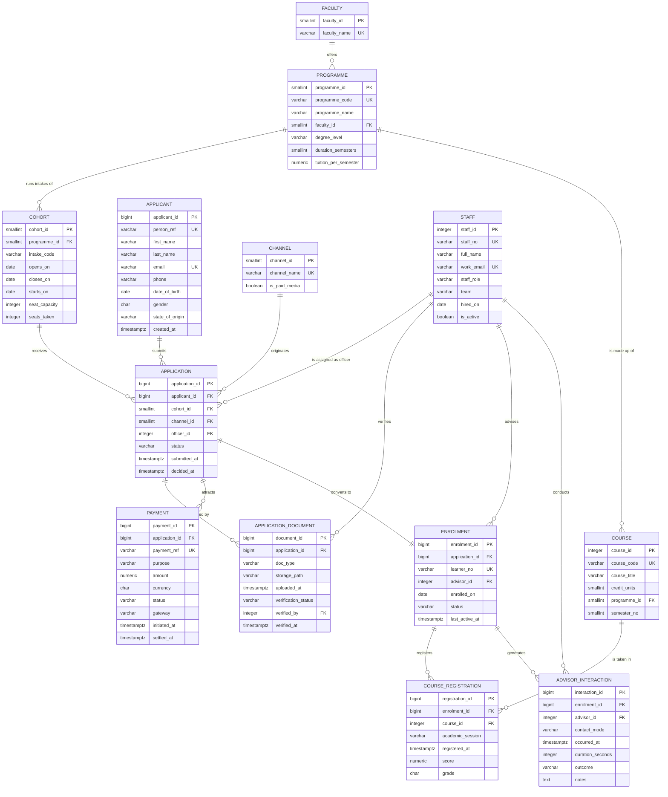

# ER Diagram — NOU Admissions & Learner Engagement

GitHub renders the Mermaid block below as a diagram directly in the browser,
so no image file is required. A PNG export is also kept in
`../docs/screenshots/` for the LMS document.

## Entity-relationship model

## Cardinality notes

| Relationship | Cardinality | How it is enforced |
|---|---|---|
| Applicant → Application | 1:M | FK `application.applicant_id`, plus `UNIQUE (applicant_id, cohort_id)` so one applicant cannot apply twice to the same intake |
| Cohort → Application | 1:M | FK `application.cohort_id` |
| Application → Enrolment | 1:1 | FK plus `UNIQUE` on `enrolment.application_id` |
| Enrolment ↔ Course | M:N | Resolved by the `course_registration` associative entity |
| Staff → Application | 1:M (optional) | `officer_id` is nullable: an application can sit unassigned in the queue |
| Staff → Enrolment | 1:M (optional) | `advisor_id` is nullable: a learner may be unassigned between advisor reshuffles |

## Why `programme_id` is not on `application`

An application belongs to a cohort, and a cohort belongs to exactly one
programme. Storing `programme_id` on `application` as well would create a
transitive dependency (`application_id → cohort_id → programme_id`) and open
the door to a row where the stored programme disagrees with the cohort's
programme. The programme is reached by joining through `cohort`. This is
discussed further in `normalisation.md`.
